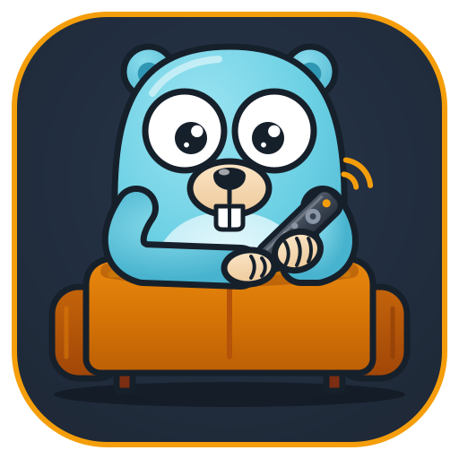
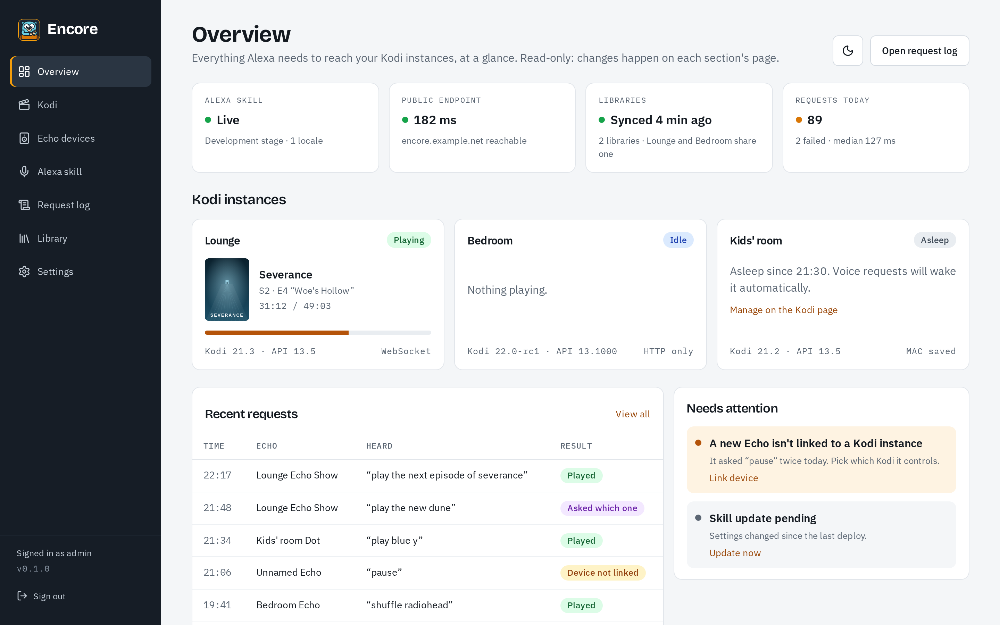
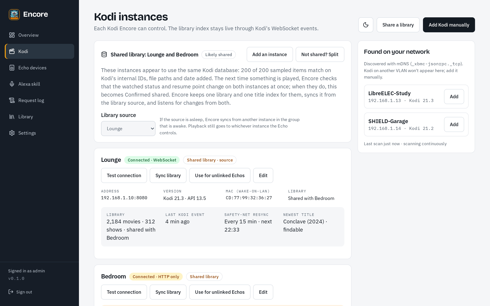
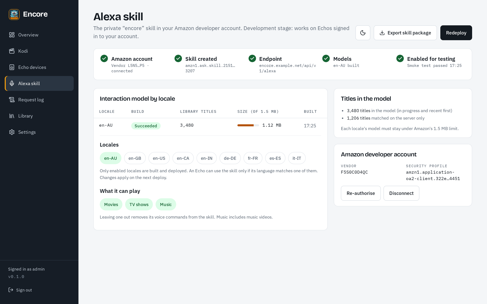
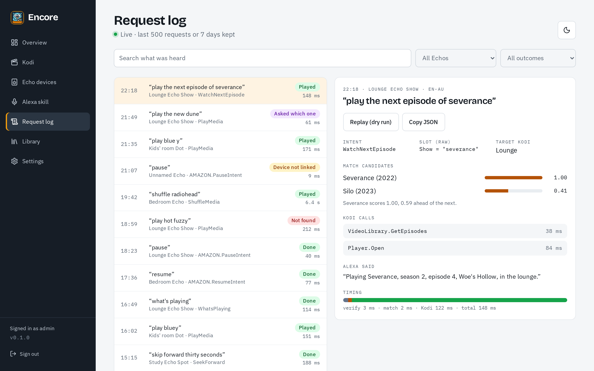
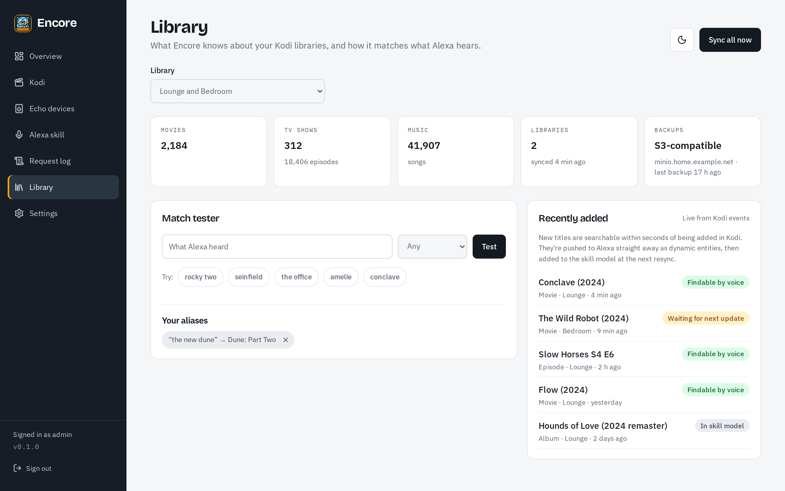

<p align="center">
  
</p>

<h1 align="center">Encore</h1>

<p align="center">Control Kodi with Alexa. Self-hosted, set up from a web interface.</p>

<p align="center">
  <a href="https://github.com/nightah/encore/actions/workflows/ci.yml"><picture><source media="(prefers-color-scheme: dark)" srcset="https://shieldcn.dev/badge/dynamic/json.svg?url=https%3A%2F%2Fimg.shields.io%2Fgithub%2Factions%2Fworkflow%2Fstatus%2Fnightah%2Fencore%2Fci.yml.json%3Fbranch%3Dmain%26cacheSeconds%3D300&query=%24.message&label=build&logo=githubactions&logoColor=%232088ff&mode=dark&size=sm&variant=outline"></picture></a>
  <a href="https://codecov.io/gh/nightah/encore"><picture><source media="(prefers-color-scheme: dark)" srcset="https://shieldcn.dev/badge/dynamic/json.svg?url=https%3A%2F%2Fimg.shields.io%2Fcodecov%2Fc%2Fgithub%2Fnightah%2Fencore.json%3FcacheSeconds%3D300&query=%24.message&label=coverage&logo=codecov&logoColor=%23f01f7a&mode=dark&size=sm&variant=outline"></picture></a>
  <a href="https://github.com/nightah/encore/blob/main/go.mod"><picture><source media="(prefers-color-scheme: dark)" srcset="https://shieldcn.dev/badge/dynamic/json.svg?url=https%3A%2F%2Fimg.shields.io%2Fgithub%2Fgo-mod%2Fgo-version%2Fnightah%2Fencore.json%3FcacheSeconds%3D300&query=%24.message&label=go&logo=go&logoColor=%2300add8&mode=dark&size=sm&variant=outline"></picture></a>
  <a href="https://www.apache.org/licenses/LICENSE-2.0"><picture><source media="(prefers-color-scheme: dark)" srcset="https://shieldcn.dev/github/nightah/encore/license.svg?label=licence&logo=apache&logoColor=%23d22128&mode=dark&size=sm&variant=outline"></picture></a>
  <a href="https://nightah.github.io/encore/getting-started/binary/"><picture><source media="(prefers-color-scheme: dark)" srcset="https://shieldcn.dev/badge/slsa-level_3.svg?logo=data%3Aimage%2Fsvg%2Bxml%3Bbase64%2CPHN2ZyB4bWxucz0iaHR0cDovL3d3dy53My5vcmcvMjAwMC9zdmciIHZpZXdCb3g9IjAgMCAyNCAyNCIgZmlsbD0ibm9uZSIgc3Ryb2tlPSIjZmY2NzQwIiBzdHJva2Utd2lkdGg9IjIiIHN0cm9rZS1saW5lY2FwPSJyb3VuZCIgc3Ryb2tlLWxpbmVqb2luPSJyb3VuZCI%2BPHBhdGggZD0iTTIwIDEzYzAgNS0zLjUgNy41LTcuNjYgOC45NWExIDEgMCAwIDEtLjY3LS4wMUM3LjUgMjAuNSA0IDE4IDQgMTNWNmExIDEgMCAwIDEgMS0xYzIgMCA0LjUtMS4yIDYuMjQtMi43MmExLjE3IDEuMTcgMCAwIDEgMS41MiAwQzE0LjUxIDMuODEgMTcgNSAxOSA1YTEgMSAwIDAgMSAxIDF6Ii8%2BPHBhdGggZD0ibTkgMTIgMiAyIDQtNCIvPjwvc3ZnPg%3D%3D&mode=dark&size=sm&variant=outline"></picture></a>
  <a href="https://crowdin.com/project/encore"><picture><source media="(prefers-color-scheme: dark)" srcset="https://shieldcn.dev/badge/dynamic/json.svg?url=https%3A%2F%2Fbadges.awesome-crowdin.com%2Fstats-15272688-941205.json&query=%24.progress.length&label=translations&suffix=%20languages&logo=crowdin&mode=dark&size=sm&variant=outline"></picture></a>
  <a href="https://nightah.github.io/encore/"><picture><source media="(prefers-color-scheme: dark)" srcset="https://shieldcn.dev/badge/docs-online.svg?logo=astro&logoColor=%23bc52ee&mode=dark&size=sm&variant=outline"></picture></a>
  <a href="https://www.conventionalcommits.org/"><picture><source media="(prefers-color-scheme: dark)" srcset="https://shieldcn.dev/badge/dynamic/json.svg?url=https%3A%2F%2Fimg.shields.io%2Fbadge%2Fcommits-conventional-blue.json&query=%24.message&label=commits&logo=conventionalcommits&logoColor=%23fe5196&mode=dark&size=sm&variant=outline"></picture></a>
  <a href="https://nightah.github.io/encore/contributing/#how-encore-is-built"><picture><source media="(prefers-color-scheme: dark)" srcset="https://shieldcn.dev/badge/AI--assisted-human--owned.svg?logo=claude&logoColor=%23d97757&mode=dark&size=sm&variant=outline"></picture></a>
</p>

<p align="center">
  <a href="https://github.com/nightah/encore/releases"><picture><source media="(prefers-color-scheme: dark)" srcset="https://shieldcn.dev/github/nightah/encore/release.svg?logo=github&mode=dark&size=sm&variant=outline"></picture></a>
  <a href="https://github.com/nightah/encore/pkgs/container/encore"><picture><source media="(prefers-color-scheme: dark)" srcset="https://shieldcn.dev/badge/container-ghcr.io%2Fnightah%2Fencore.svg?logo=docker&logoColor=%232496ed&mode=dark&size=sm&variant=outline"></picture></a>
  <a href="https://kodi.tv"><picture><source media="(prefers-color-scheme: dark)" srcset="https://shieldcn.dev/badge/kodi-21%2B.svg?logo=kodi&logoColor=%2317b2e7&mode=dark&size=sm&variant=outline"></picture></a>
  <a href="https://developer.amazon.com/alexa/alexa-skills-kit"><picture><source media="(prefers-color-scheme: dark)" srcset="https://shieldcn.dev/badge/alexa-custom_skill.svg?logo=data%3Aimage%2Fsvg%2Bxml%3Bbase64%2CPHN2ZyB4bWxucz0iaHR0cDovL3d3dy53My5vcmcvMjAwMC9zdmciIHZpZXdCb3g9IjAgMCAyNCAyNCIgZmlsbD0ibm9uZSIgc3Ryb2tlPSIjMDBjYWZmIiBzdHJva2Utd2lkdGg9IjIiIHN0cm9rZS1saW5lY2FwPSJyb3VuZCIgc3Ryb2tlLWxpbmVqb2luPSJyb3VuZCI%2BPHBhdGggZD0iTTEyIDE5djMiLz48cGF0aCBkPSJNMTkgMTB2MmE3IDcgMCAwIDEtMTQgMHYtMiIvPjxyZWN0IHg9IjkiIHk9IjIiIHdpZHRoPSI2IiBoZWlnaHQ9IjEzIiByeD0iMyIvPjwvc3ZnPg%3D%3D&mode=dark&size=sm&variant=outline"></picture></a>
</p>

<p align="center">
  <a href="https://github.com/sponsors/nightah"><picture><source media="(prefers-color-scheme: dark)" srcset="https://shieldcn.dev/badge/dynamic/json.svg?url=https%3A%2F%2Fimg.shields.io%2Fbadge%2Fsponsor-nightah-blue.json&query=%24.message&label=sponsor&logo=githubsponsors&logoColor=%23ea4aaa&mode=dark&size=sm&variant=outline"></picture></a>
  <a href="https://ko-fi.com/nightah"><picture><source media="(prefers-color-scheme: dark)" srcset="https://shieldcn.dev/badge/dynamic/json.svg?url=https%3A%2F%2Fimg.shields.io%2Fbadge%2Fko--fi-nightah-blue.json&query=%24.message&label=ko-fi&logo=kofi&logoColor=%23ff5e5b&mode=dark&size=sm&variant=outline"></picture></a>
</p>

---

Encore is a self-hosted Alexa skill server for Kodi, and a modern successor to the archived [Kanzi](https://github.com/m0ngr31/kanzi) skill:

- **Everything Kanzi did:** play movies, shows, music and playlists by name, "next episode of…", recommendations, playback, volume and navigation, across nine locales.
- **Set up from a web UI:** connect Kodi, link Echo devices to rooms, watch a live request log, and test how titles are matched.
- **One-click deploy:** Encore creates and updates the private skill in your own Amazon developer account through the Skill Management API.
- **Finds new titles straight away:** Kodi's live events keep the library index current, so something added a minute ago is findable by voice.

> **Status:** early releases (0.x), working towards 1.0; see the [latest release](https://github.com/nightah/encore/releases/latest). Voice control, the web interface and skill deployment work end to end with a real Amazon developer account and Echo, tested in en-AU. Expect rough edges, and breaking changes are possible before 1.0. The other locales haven't been tried on real devices yet, so [reports](https://github.com/nightah/encore/issues) from them are welcome.

**Documentation:** <https://nightah.github.io/encore/> (source in [`docs/`](docs/)).

## Screenshots

<picture>
  <source media="(prefers-color-scheme: dark)" srcset="docs/src/assets/screenshots/overview-dark.png">
  
</picture>

<table>
  <tr>
    <td><picture>
  <source media="(prefers-color-scheme: dark)" srcset="docs/src/assets/screenshots/kodi-dark.png">
  
</picture></td>
    <td><picture>
  <source media="(prefers-color-scheme: dark)" srcset="docs/src/assets/screenshots/alexa-skill-dark.png">
  
</picture></td>
  </tr>
  <tr>
    <td><picture>
  <source media="(prefers-color-scheme: dark)" srcset="docs/src/assets/screenshots/request-log-dark.png">
  
</picture></td>
    <td><picture>
  <source media="(prefers-color-scheme: dark)" srcset="docs/src/assets/screenshots/library-dark.png">
  
</picture></td>
  </tr>
</table>

More in the [tour of the web interface](https://nightah.github.io/encore/tour/).

## Running

Encore ships as a single binary and a multi-arch container image. It listens on one HTTP port (default `8080`) and expects to sit behind a reverse proxy that terminates TLS. Only `/api/v1/alexa` needs to be reachable from the internet.

```sh
docker run -d --name encore \
  -e PUID=1000 -e PGID=1000 \
  -p 8080:8080 \
  -v /path/to/encore:/config \
  ghcr.io/nightah/encore
```

The image is built on [antilax3's Alpine s6-overlay base](https://hub.docker.com/r/antilax3/alpine) for amd64, arm64 and armv7 (32-bit Raspberry Pi OS). `PUID`/`PGID` choose the user Encore runs as, and `/config` holds its database, secrets key, local storage and an optional `encore.yml` (loaded automatically).

Kodi instances are added in the web interface: the setup wizard and the Kodi page find them on your network or take an address. They can also be declared in `encore.yml` (in `/config` for the container, or pass `--config`), and are then shown as managed by config:

```yaml
kodi:
  - name: Lounge
    url: http://192.168.1.20:8080/jsonrpc
    username: kodi
    password: "…"                                  # or enter it in the web interface, where it is stored encrypted
    websocket_url: ws://192.168.1.20:9090/jsonrpc  # live library updates; enable "Allow remote control from applications on other systems" in Kodi
    default: true                                  # answers Echos that aren't linked to an instance
```

On first start Encore logs a one-time setup token; open the web interface and use it to create the admin account. Admins can instead sign in through an OpenID Connect provider (`auth.mode: oidc` with `auth.oidc.issuer`, `client_id`, `client_secret` and optionally `admin_group`) or a reverse proxy's `Remote-User`/`Remote-Groups` headers (`auth.mode: header`; honoured only from `server.trusted_proxies`). To keep password sign-in as a way back in if the provider or proxy breaks, turn on the break-glass login under Settings › Access; if you're already locked out, `ENCORE_BREAK_GLASS=true` re-enables it until you remove it. These settings can also be changed in the web interface; values set in config are shown there as managed.

Kodi instances that share one library database (MySQL/MariaDB) are detected automatically: Encore compares a sample of each library and then watches for a play count or resume point saved on one Kodi to show up on the others. Shared instances get one library index between them, synced from one of them (the first added, or the one you choose), with another taking over while it sleeps. To decide yourself, give instances the same `library_group: <name>`, or `library_group: none` to keep one on its own.

The library index is also saved to the configured storage after syncs, so Encore can answer voice requests straight after a restart, before Kodi is queried again.

Configuration comes from defaults, an optional YAML file (`encore.yml` in the data directory, or `--config`), `ENCORE_*` environment variables (the key in upper case with dots as underscores, e.g. `ENCORE_SERVER_ADDRESS`; `_FILE` suffixes read secrets from files), then flags.

### Stateless deployment

Encore can also run without a persistent volume (on Kubernetes, Cloud Run, Fly and similar hosts), keeping its database in S3-compatible or WebDAV storage. See [Stateless deployment](https://nightah.github.io/encore/guides/stateless/).

### Backups and restore

Encore backs up its database to the configured storage on a schedule and on demand, and `encore restore` puts a backup back. Keep the secrets key somewhere safe as well: a backup can't be restored without it. See [Storage and backups](https://nightah.github.io/encore/guides/storage/#backups).

## Development

See [CONTRIBUTING.md](CONTRIBUTING.md). Quick start:

```sh
make dev     # the server (rebuilt on changes) and the web UI at http://localhost:3000
make test    # Go, tools and web tests
make lint    # golangci-lint, interaction-model lint, Biome, tsc and the repository checks
```

## Translations

Encore is translated on [Crowdin](https://crowdin.com/project/encore), where anyone can sign in and help. See [Translations](https://nightah.github.io/encore/contributing/#translations) for what's translated and how changes reach the repository.

<p>
  <a href="https://crowdin.com/project/encore/fr"><picture><source media="(prefers-color-scheme: dark)" srcset="https://shieldcn.dev/badge/dynamic/json.svg?url=https%3A%2F%2Fbadges.awesome-crowdin.com%2Fstats-15272688-941205.json&query=%24.progress%5B%3F%28%40.data.languageId%3D%3D%27fr%27%29%5D.data.translationProgress&label=French&labelGap=19&logo=crowdin&mode=dark&size=sm&variant=outline"></picture></a><br>
  <a href="https://crowdin.com/project/encore/de"><picture><source media="(prefers-color-scheme: dark)" srcset="https://shieldcn.dev/badge/dynamic/json.svg?url=https%3A%2F%2Fbadges.awesome-crowdin.com%2Fstats-15272688-941205.json&query=%24.progress%5B%3F%28%40.data.languageId%3D%3D%27de%27%29%5D.data.translationProgress&label=German&labelGap=12&logo=crowdin&mode=dark&size=sm&variant=outline"></picture></a><br>
  <a href="https://crowdin.com/project/encore/it"><picture><source media="(prefers-color-scheme: dark)" srcset="https://shieldcn.dev/badge/dynamic/json.svg?url=https%3A%2F%2Fbadges.awesome-crowdin.com%2Fstats-15272688-941205.json&query=%24.progress%5B%3F%28%40.data.languageId%3D%3D%27it%27%29%5D.data.translationProgress&label=Italian&labelGap=26&logo=crowdin&mode=dark&size=sm&variant=outline"></picture></a><br>
  <a href="https://crowdin.com/project/encore/es-ES"><picture><source media="(prefers-color-scheme: dark)" srcset="https://shieldcn.dev/badge/dynamic/json.svg?url=https%3A%2F%2Fbadges.awesome-crowdin.com%2Fstats-15272688-941205.json&query=%24.progress%5B%3F%28%40.data.languageId%3D%3D%27es-ES%27%29%5D.data.translationProgress&label=Spanish&labelGap=12&logo=crowdin&mode=dark&size=sm&variant=outline"></picture></a>
</p>

## How Encore is built

Encore is an AI-assisted project. Its maintainer designs it, sets its architecture and conventions, and understands and owns every line of it; AI coding agents (Claude Code) speed up writing the code, tests and documentation. Every change is reviewed and committed by the maintainer, who signs off and GPG-signs every commit, and every change passes the same checks: linting, race-enabled tests, coverage thresholds, generated code with no diff and a docs build. Releases are built in CI with [SLSA Build Level 3](https://slsa.dev/spec/v1.0/levels#build-l3) provenance. The maintainer is responsible for what ships, bugs included, and [reports](https://github.com/nightah/encore/issues) are welcome.

AI-assisted contributions are welcome too, on the terms in [Contributing](https://nightah.github.io/encore/contributing/#ai-assisted-contributions).

## Support

If Encore is useful to you, support its development through [GitHub Sponsors](https://github.com/sponsors/nightah) or [Ko-fi](https://ko-fi.com/nightah).

## Licence

Apache-2.0. See [LICENSE](LICENSE) and [ATTRIBUTION.md](docs/brand/ATTRIBUTION.md) for the logo credit.
